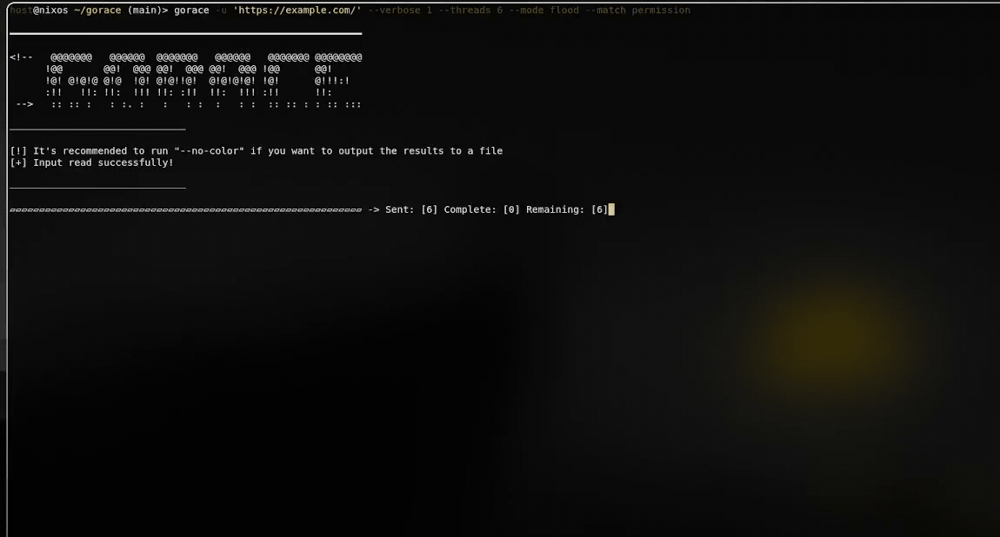
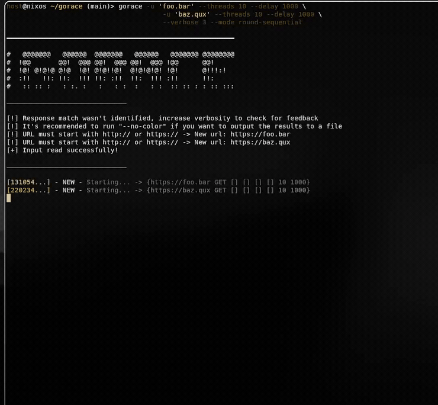
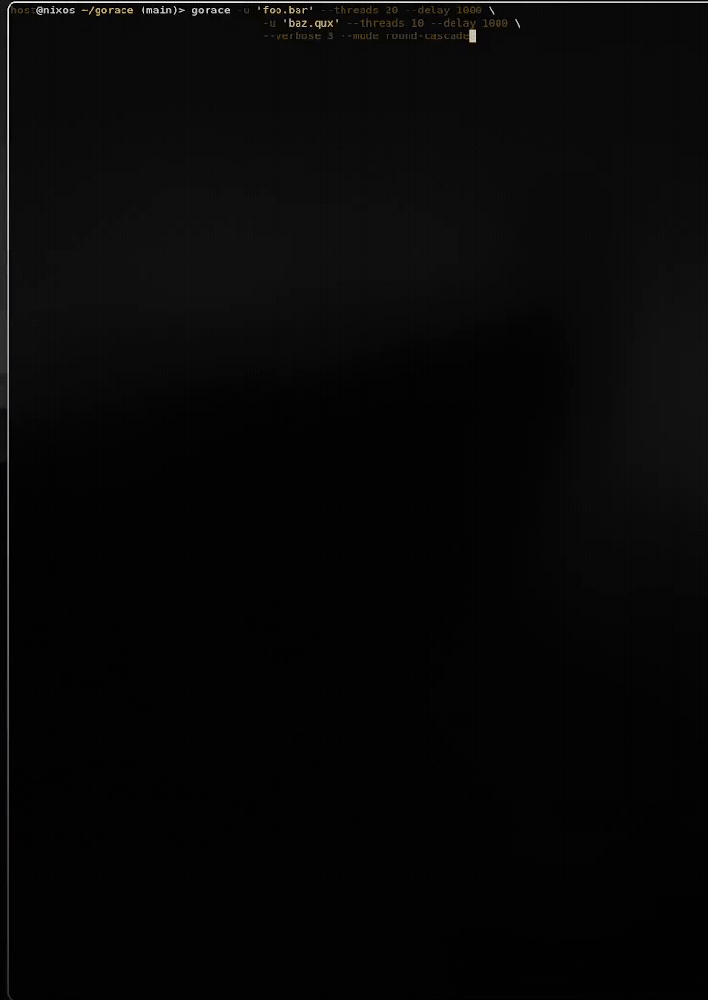

<p align="center">
<br>
gorace: Race Condition Testing Tool Written in Go
</p>

gorace queues HTTP requests and releases them through multiple timing modes (flood, cascade, round-cascade and more), instead of firing them one at a time like typical fuzzers.

<!-- Demo video -->
<!-- 
https://github.com/user-attachments/assets/YOUR-VIDEO-ID-HERE
-->

<hr>

## Installation

**Status:** AUR publication and NUR registration pending. Nix installation is available directly from the package repository below.

### AUR package
```bash
yay -S gorace
```
This will install the `gorace` package from the AUR using `yay`.

### Nix

Install the packaged release from [nur-packages](https://github.com/MatheusBrunheroto/nur-packages), with Nixpkgs available in `NIX_PATH`:

```bash
git clone https://github.com/MatheusBrunheroto/nur-packages.git
nix-env -f ./nur-packages -iA gorace --arg pkgs 'import <nixpkgs> {}'
```

After NUR registration is accepted and its index is updated, users with NUR configured will also be able to use `pkgs.nur.repos.matheusbrunheroto.gorace`. See the package repository for NixOS configuration examples.

### Manual (Building from source)
```bash
git clone https://github.com/MatheusBrunheroto/gorace.git
cd gorace
chmod +x install.sh
./install.sh
```
This will compile the current source and install the `gorace` binary to `/usr/local/bin` using `sudo`, making it available globally in your terminal.

**Requirements:** Go 1.25 or higher.

<hr>

## Usage

Usage Example:
```bash
gorace -u 'https://x.com' -d 'FUZZ=payload' -w 'FUZZ=./wordlist.txt' --threads 10 --delay 100 \
       -u 'https://y.com' --threads 10 --delay 1000 --verbose 3 --match e
```

Every `-u` starts a new target. Any flags set before the next `-u` (headers, cookies, data, wordlist, threads, delay) apply only to that target — so a single command can test multiple websites at once, each with its own configuration.

## Modes
<!-- Usage gifs -->
### • Flood mode (verbose 1 and 2)

```bash
gorace -u 'https://example.com/' --verbose 1 --threads 6 --mode flood --match permission
```
```bash
gorace -u 'https://example.com/' --verbose 2 --threads 6 --mode flood --match permission
```
<br>

### • Sequential mode (verbose 3)

```bash
gorace -u 'foo.bar' --threads 10 --delay 1000 \
       -u 'baz.qux' --threads 10 --delay 1000 \
       --verbose 3 --mode sequential
```
<br>

### • Round-Sequential mode (verbose 3)

```bash
gorace -u 'foo.bar' --threads 10 --delay 1000 \
       -u 'baz.qux' --threads 10 --delay 1000 \
       --verbose 3 --mode round-sequential
```
<br>

### • Cascade mode (verbose 3)

```bash
gorace -u 'foo.bar' --threads 10 --delay 1000 \
       -u 'baz.qux' --threads 10 --delay 1000 \
       --verbose 3 --mode cascade
```
<br>

### • Round-Cascade mode (verbose 3)

```bash
gorace -u 'foo.bar' --threads 20 --delay 1000 \
       -u 'baz.qux' --threads 10 --delay 1000 \
       --verbose 3 --mode round-cascade
```

<hr>

## Inspiration

This repository was created to explore the [Race Condition](https://portswigger.net/web-security/race-conditions) challenges from PortSwigger Academy while learning [Go](https://go.dev/). The CLI was inspired by one of the most powerful fuzzing tools available, [FFUF](https://github.com/ffuf/ffuf).
